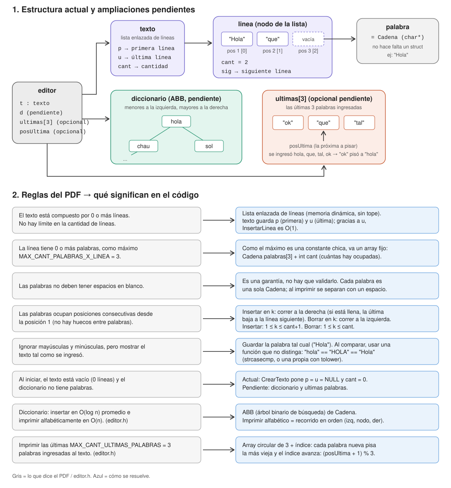

# Obligatorio EDA 2026 - Editor de texto

## Avance

Las casillas marcadas indican operaciones con implementacion y pruebas realizadas. Los pendientes y las correcciones conocidas se detallan abajo.

**Tipos (según el PDF):**
- **TIPO 1 - imprescindible**: si falta alguna, el obligatorio **no se corrige**.
- **TIPO 2 - importante**: se prueban solo si las de TIPO 1 andan bien.
- **OPCIONAL**: suman hasta 10 puntos extra.

**Fechas:**
- Control intermedio: operaciones 1 a 11, semana del 25 de octubre de 2026.
- Entrega final: operaciones 1 a 16, hasta el 18 de noviembre de 2026 a las 23:59 (Moodle + defensa).

### Estructuras (hacen falta para todo lo demás)
- [x] `nodo_linea` con `palabras[3]` y `cant`
- [ ] Módulo `diccionario` (ABB) + agregarlo al makefile
- [ ] Últimas palabras (array circular) en el editor
- [ ] `CrearEditor` *(a medias: solo crea el texto)*

### Operaciones del PDF
- [x] **1** `InsertarLinea` - TIPO 1
- [x] **2** `InsertarLineaEnPosicion` - TIPO 1
- [x] **3** `BorrarLinea` - TIPO 2
- [x] **4** `BorrarTodo` - TIPO 2
- [x] **5** `BorrarOcurrenciasPalabraEnTexto` - TIPO 1
- [x] **6** `ImprimirTexto` - TIPO 1
- [ ] **7** `ComprimirTexto` - OPCIONAL
- [x] **8** `InsertarPalabra` - TIPO 1
- [x] **9** `BorrarPalabra` - TIPO 1
- [x] **10** `BorrarOcurrenciasPalabraEnLinea` - TIPO 1
- [x] **11** `ImprimirLinea` - TIPO 1
- [ ] **12** `IngresarPalabraDiccionario` - TIPO 1
- [ ] **13** `BorrarPalabraDiccionario` - TIPO 2
- [ ] **14** `ImprimirDiccionario` - TIPO 1
- [ ] **15** `ImprimirTextoIncorrecto` - TIPO 2
- [x] **16** `ImprimirUltimasPalabras` - OPCIONAL

### Sin número en el PDF
- [ ] `DestruirEditor` (está en `../editor.h`, liberar toda la memoria) *(a medias: libera el texto, falta el diccionario)*

## Cómo está armado



Actualmente `editor` contiene solo `texto t`. El diccionario y las ultimas palabras estan pendientes. La estructura prevista es la siguiente.

1. **texto**: lista enlazada de líneas. Guarda `p` (primera) y `u` (última). Con `u` insertar al final es O(1).
2. **diccionario**: ABB (árbol binario de búsqueda) de palabras. Recorrido en orden = alfabético.
3. **ultimas[3]**: array circular con las últimas 3 palabras ingresadas al texto.

Cada **línea** es un nodo de la lista con un array fijo de 3 palabras (`MAX_CANT_PALABRAS_X_LINEA`), un contador `cant` y el puntero `sig`.
Una **palabra** es directamente una `Cadena` (`char*`), no hace falta un struct.

## Structs

```c
// linea.c
struct nodo_linea {
    Cadena palabras[MAX_CANT_PALABRAS_X_LINEA];
    int cant;          // cuántas palabras hay (ocupan de 0 a cant-1)
    linea sig;         // siguiente línea
};

// texto.c (implementado)
struct nodo_texto {
    linea p;           // primera línea
    linea u;           // última línea
    int cant;          // cantidad de lineas
};

// diccionario.c (hay que crearlo)
struct nodo_diccionario {
    Cadena palabra;
    diccionario izq, der;
};

// editor.c (actual)
struct nodo_editor {
    texto t;
};

// Pendiente: agregar el diccionario.
// Para el opcional 16, agregar ultimas y posUltima.
```

## Reglas del PDF y qué significan

| El PDF dice | En el código |
|---|---|
| El texto tiene 0 o más líneas, sin límite | Lista enlazada (memoria dinámica). |
| La línea tiene 0 a 3 palabras | Array fijo `palabras[3]` + `cant`. |
| Las palabras no tienen espacios | Es una garantía, no se valida. Al imprimir se separan con un espacio. |
| Posiciones consecutivas desde 1, sin huecos | Insertar en `k` corre a la derecha. Si la línea se llena, la última palabra baja a la siguiente línea (y así en cascada; si hace falta se crea una línea nueva al final). Borrar en `k` corre a la izquierda. Para insertar, `1 <= k <= cant+1`. Para borrar, `1 <= k <= cant`. Posición 1 = índice 0. |
| Ignorar mayúsculas/minúsculas, pero mostrar como se ingresó | Se guarda tal cual (`"Hola"`). Para comparar se usa una función que no distinga (`strcasecmp` o una propia con `tolower`). |
| Al iniciar, texto y diccionario vacíos | `CrearTexto` inicializa `p = u = NULL` y `cant = 0`. Falta inicializar el diccionario y, para el opcional 16, las ultimas palabras. |
| Diccionario: insertar O(log n) promedio, imprimir O(n) | ABB, imprimir con recorrido en orden. |
| Últimas 3 palabras | Array circular: la nueva pisa la más vieja, `posUltima = (posUltima + 1) % 3`. |

## Validaciones y memoria

Las operaciones de `editor.c` validan las posiciones y devuelven `ERROR` u `OK`. Las auxiliares implementadas en `texto.c` son `void` y reciben posiciones ya validadas. `CantidadPalabrasLinea` requiere que la linea exista.

Para insertar una linea se admite hasta cantidad de lineas + 1. El caso de agregar al final se deriva a `InsertarLinea`, que actualiza `u`. Para insertar o borrar palabras, la linea debe existir.

Las lineas se buscan recorriendo desde `t->p` con `SiguienteLinea`. Al insertar una palabra se reserva una copia con `new char[strlen(palabra) + 1]` y se copia con `strcpy`. Cada palabra se libera con `delete[]` y cada nodo de linea con `delete`.

`BorrarOcurrenciasPalabraEnLinea` saltea espacios iniciales con `palabraABorrar[0]`, porque el lector de comandos puede incluirlos. Las comparaciones usan `strcasecmp`.

## Verificaciones realizadas

Los ejemplos del PDF de las operaciones 1 a 6 coincidieron con las salidas esperadas en la prueba realizada. Tambien se probaron la insercion de palabras con desborde y el borrado de ocurrencias en una linea, incluyendo mayusculas, repeticiones y posiciones invalidas. Estas pruebas corresponden a la version revisada durante la sesion.

El punto 11 actualmente devuelve `NO_IMPLEMENTADA`. Los puntos 7 y 12 a 16 tambien estan pendientes. En el punto 9 queda corregir el limite mencionado en la lista de avance.
